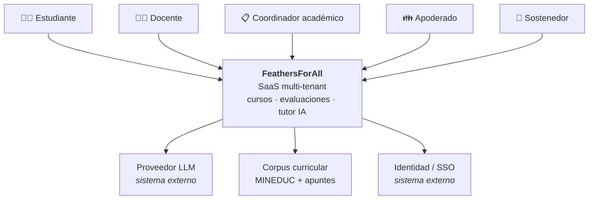
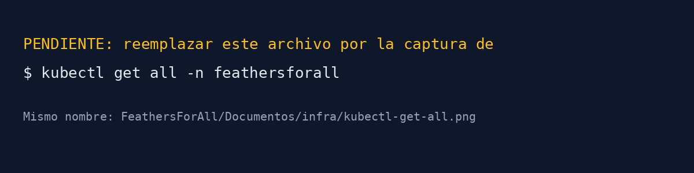

# FeathersForAll

> Plataforma SaaS multi-tenant con tutor IA para colegios de la Región Metropolitana.
> Proyecto del **Taller de Ingeniería de Software** · 18 sesiones · Semestre 2026.
> Construido sobre la iniciativa **AulaViva** del taller; FeathersForAll es la marca propia del producto.

[](FeathersForAll/Documentos/adr/0001-eleccion-iniciativa.md)
[](FeathersForAll/Documentos/adr/0001-eleccion-iniciativa.md)
[](FeathersForAll/Documentos/Entregables/Charter.md)

---

## Qué es esto

Un grupo de colegios necesita modernizar su experiencia de aprendizaje. FeathersForAll entrega a docentes y estudiantes una plataforma multi-tenant con gestión de cursos, evaluaciones auto-corregidas y un **tutor IA anclado al currículum vigente del MINEDUC** mediante RAG sobre los apuntes de cada curso.

**Alcance mínimo comprometido (MVP):**

1. Multi-tenancy real — 1 colegio = 1 tenant aislado lógicamente.
2. Gestión de cursos, docentes y estudiantes con RBAC.
3. Evaluaciones auto-corregidas con retroalimentación.
4. Tutor IA con RAG sobre los apuntes de cada curso.
5. Panel del apoderado con seguimiento de avance.

**Restricciones de ingeniería que nos definen:** aislamiento entre tenants, tratamiento de datos de menores, escalabilidad horizontal ante picos en periodo de pruebas, y control de costo del LLM por tenant.

---

## Contexto del sistema (borrador)

Boceto preliminar de actores y límites. Se formaliza como modelo **C4** en la S03.



---

## Equipo

| Integrante | Rol | Área |
|---|---|---|
| Juan | Product Owner | Backlog y valor |
| Iván | Tech Lead | Arquitectura y ADRs |
| Ignacio | DevSecOps Lead | CI/CD, seguridad, observabilidad |
| Bastián | AI/Data Lead | RAG, datos y métricas del modelo |
| Cristofer | QA Lead | Estrategia de pruebas |
| Alex | QA — Automatización | Suite automatizada y quality gates |

Roles, reglas de trabajo, Definition of Done y política de IA: **[CHARTER.md](FeathersForAll/Documentos/Entregables/Charter.md)**.

---

## Estructura del repositorio

```text
.
├── readme.md
├── models.md                           # Contexto del taller (PPT S01–S07) y estado del proyecto
├── code/
│   ├── backend/                        # API Node.js + Express (monolito modular) + Dockerfile (S07)
│   │   ├── compose.yaml                # Base local con Docker (PostgreSQL 16 + pgvector + datos demo)
│   │   ├── requests/postman/           # Colección Postman con la matriz de permisos
│   │   └── db/                         # Esquema PostgreSQL (01–04 + permisos), consultas y pruebas
│   └── frontend/                       # React + Vite (ADR 0005): chat + portal por rol (portal.html) + Dockerfile (S07)
├── .github/workflows/                  # CI/CD: quality gates, imágenes a GHCR y promoción GitOps (S08)
├── k8s/                                # Manifiestos Kubernetes con Kustomize + clúster kind (S07); desde S08 el despliegue vive en el repo gitops
├── terraform/                          # IaC: namespace, cuota y Secret del equipo (S07)
└── FeathersForAll/
    ├── .spectral.yaml                  # Reglas de lint del contrato (S05)
    ├── api/
    │   ├── openapi.yaml                # Contrato OpenAPI 3.1 (v1.1.0: 14 operaciones)
    │   └── examples/                   # Ejemplos ejecutables + run-examples.mjs
    ├── packages/
    │   └── api-client/                 # Cliente TypeScript generado
    └── Documentos/
        ├── Entregables/
        │   └── Charter.md              # Acta del equipo: roles, DoD, política de IA
        ├── adr/                        # Architecture Decision Records (0001–0008)
        ├── arch/
        │   └── atributos-calidad.md    # Top 3 NFRs con métricas
        ├── c4/                         # l1-context y l2-container (.puml + .png)
        ├── scenarios/                  # 15 escenarios Gherkin (h1..h5 .feature)
        ├── api/
        │   └── versioning-policy.md    # Política de versionado (S05)
        ├── cloud/
        │   └── managed-services.md     # Servicios gestionados y trazabilidad (S04)
        ├── data/                       # S06: DER, catálogo de eventos, bounded contexts
        ├── diseno/
        │   └── prototipo-portal.html   # Prototipo navegable de las 34 pantallas del portal (referencia)
        ├── 12-factor-checklist.md      # Auditoría 12-Factor (S04)
        ├── impact-map.md
        └── backlog.md                  # 5 historias INVEST + MoSCoW
```

### Contenedores, Kubernetes e IaC (S07)

| Pieza | Dónde | Resumen |
|---|---|---|
| Imagen de la API | `code/backend/Dockerfile` | Multi-stage: `deps` → `test` (corre `npm test`) → runtime **distroless** `nodejs22-debian13:nonroot`. Sin shell, sin root (211 MB; meta < 200 MB pendiente) |
| Imagen del frontend | `code/frontend/Dockerfile` | Build con Vite → `nginx-unprivileged:1.30-alpine` + parches de Alpine (uid 101, puerto 8080) |
| Manifiestos | `k8s/` | Kustomize: Deployment, Service, Ingress, ConfigMap, HPA (2–6 réplicas, CPU 65 %), PDB. Imágenes por **digest** |
| Infraestructura | `terraform/` | Namespace con Pod Security `restricted`, ResourceQuota, LimitRange y Secret. State remoto con locking (backend `pg`), un workspace por ambiente |
| Decisión | [ADR 0006](FeathersForAll/Documentos/adr/0006-plataforma-k8s.md) | kind + Kustomize + Terraform; base images distroless / nginx-unprivileged |

```powershell
kind create cluster --config k8s/cluster/kind.yaml      # + ingress-nginx y metrics-server (k8s/README.md)
cd terraform; terraform init; terraform workspace select -or-create dev; terraform apply -var-file=envs/dev.tfvars; cd ..
.\k8s\tools\publicar-imagenes.ps1                        # build + push a GHCR + digest en kustomization.yaml
kubectl apply -k k8s/
kubectl get all -n feathersforall                        # → http://localhost:8088
```

Paso a paso completo (con la prueba del HPA): [`k8s/README.md`](k8s/README.md).

### CI/CD y GitOps (S08)

| Pieza | Dónde | Resumen |
|---|---|---|
| Pipeline | `.github/workflows/ci.yml` | Gates bloqueantes: contrato, lint, pruebas con cobertura ≥ 70 % (backend con PostgreSQL real), SCA, SAST (Semgrep), e2e (Compose + Newman) y Trivy. En `main`: imágenes a GHCR por `sha` y PR al repo gitops |
| Promoción a prod | `.github/workflows/promote-prod.yml` | Manual, con aprobación del Environment `production` y PR con 2 revisores |
| Repo gitops | [`Erolayer-Cl/feathersforall-gitops`](https://github.com/Erolayer-Cl/feathersforall-gitops) | Kustomize `base/` + `overlays/{dev,prod}/` y Applications de Argo CD |
| Vulnerabilidades | [`Documentos/seguridad/vulnerabilidades.md`](FeathersForAll/Documentos/seguridad/vulnerabilidades.md) | Hallazgos de los gates con CVE, CWE y CVSS |
| Decisión | [ADR 0009](FeathersForAll/Documentos/adr/0009-ci-cd-y-gitops.md) | GitHub Actions + GitHub Flow + GitOps pull-based con Argo CD |

Puesta en marcha (repo gitops, token, Environment, protección de rama y Argo CD): [`Documentos/infra/ci-cd.md`](FeathersForAll/Documentos/infra/ci-cd.md).

**Evidencia — `kubectl get all -n feathersforall`:**



### Datos (S06)

Esquema en `code/backend/db/`: `01_schema.sql` (base del equipo, ver `CAMBIOS_SCHEMA.md`) + `02_s06_ajustes.sql` (tutor asíncrono, periodo, retroalimentación por pregunta, outbox, idempotencia, login por RBD, embeddings de 1024 para bge-m3 y permisos por rol). Requiere PostgreSQL 16 con las extensiones `citext` y `vector` (pgvector).

```bash
# BD local (ej. "laura")
psql -d laura -v ON_ERROR_STOP=1 -f code/backend/db/01_schema.sql -f code/backend/db/02_s06_ajustes.sql

# Pruebas en una BD de prueba vacía (con superusuario: crea roles de prueba)
createdb feathersforall_test
cd code/backend/db
psql -d feathersforall_test -v ON_ERROR_STOP=1 -f 01_schema.sql -f 02_s06_ajustes.sql -f 98_test_s06_ajustes.sql
```

La API se conecta con el rol `feathersforall_app` (sin BYPASSRLS) y abre cada request con `BEGIN; SET LOCAL app.colegio_id = '<uuid>'; SET LOCAL app.usuario_id = '<uuid>'; SET LOCAL app.rol = '<rol>';` (datos del JWT verificado). Solo el docente del curso o el admin suben material y crean evaluaciones; el estudiante solo rinde y pregunta a su nombre. El relay de la outbox y el master usan `feathersforall_plataforma`. Consultas listas en `code/backend/db/queries.js`.

DER: `FeathersForAll/Documentos/data/der.png` · Eventos: `data/event-catalog.md` · Contextos: `data/bounded-contexts.md`.

### Probar la API y el portal (etapa 1, rol estudiante)

```bash
cd code/backend
docker compose up -d && npm install && npm run dev     # base con datos demo + API en :3000
cd ../frontend && npm install && npm run dev            # portal en http://localhost:5173/portal.html
```

Credenciales demo: RBD `99901`, `camila@demo-a.cl`, contraseña `demo1234` (más usuarios en [code/backend/README.md](code/backend/README.md)). Colección de Postman: `code/backend/requests/postman/`. Matriz de permisos: [permisos.md](FeathersForAll/Documentos/api/permisos.md).

### API (S05, contract-first)

```bash
cd FeathersForAll
npx @stoplight/spectral-cli lint api/openapi.yaml    # lint del contrato
npx @stoplight/prism-cli mock api/openapi.yaml       # mock en http://127.0.0.1:4010
node api/examples/run-examples.mjs                   # ejemplos contra el mock (otra terminal)
```

Documentación viva: abrir `api/openapi.yaml` en https://editor.swagger.io o con Redoc.

---

## Decisiones arquitectónicas (ADR)

Toda decisión cara de revertir se registra como ADR con el formato **Título · Contexto · Decisión · Consecuencias · Fecha · Autores**.

| ADR | Título | Estado | Fecha |
|---|---|---|---|
| [0001](FeathersForAll/Documentos/adr/0001-eleccion-iniciativa.md) | Elección de la iniciativa del semestre: AulaViva | Aceptada | 21-08-2026 |
| [0002](FeathersForAll/Documentos/adr/0002-estilo-arquitectonico.md) | Estilo arquitectónico: modular monolith (incluye aislamiento multi-tenant con RLS, Tutor IA como contenedor con módulo aislado y worker con cola) | Aceptada (por ratificar en reunión) | 28-09-2026 |
| [0003](FeathersForAll/Documentos/adr/0003-cloud.md) | Decisión cloud: arquitectura híbrida Vercel + Render + AWS | Aceptada (por ratificar en reunión) | 28-09-2026 |
| [0004](FeathersForAll/Documentos/adr/0004-datos-y-eventos.md) | Datos y eventos: PostgreSQL + pgvector con RLS, SQS y Outbox | Propuesta | 07-10-2026 |
| [0005](FeathersForAll/Documentos/adr/0005-frontend-react.md) | Frontend con React + Vite (reemplaza la línea de frontend del ADR 0002) | Propuesta | 07-10-2026 |
| [0006](FeathersForAll/Documentos/adr/0006-plataforma-k8s.md) | Contenedores, Kubernetes e IaC: distroless, kind, Kustomize y Terraform | Propuesta | 14-10-2026 |
| [0007](FeathersForAll/Documentos/adr/0007-autenticacion-y-privacidad.md) | Autenticación propia por RBD y privacidad de lectura por usuario | Propuesta | 16-10-2026 |
| [0008](FeathersForAll/Documentos/adr/0008-conversaciones-del-tutor.md) | Conversaciones del tutor IA guardadas y privadas del estudiante | Propuesta | 19-10-2026 |
| [0009](FeathersForAll/Documentos/adr/0009-ci-cd-y-gitops.md) | CI/CD con GitHub Actions y GitOps pull-based con Argo CD (repo gitops separado) | Propuesta | 26-10-2026 |

Para crear una nueva: copiar `FeathersForAll/Documentos/adr/template.md` con el número correlativo y enlazarla en esta tabla.

---

## Cómo contribuir

1. Toma una issue del board y muévela a `In Progress`.
2. Crea la rama desde `develop`: `feat/<n°issue>-descripcion-corta`.
3. Commits en formato [Conventional Commits](https://www.conventionalcommits.org).
4. Si usaste IA, decláralo con el trailer `AI-Assisted:` en el commit y completa la sección correspondiente del PR.
5. Abre el PR contra `develop` con `Closes #NN`. Requiere 1 aprobación y CI en verde.
6. Verifica el [Definition of Done](FeathersForAll/Documentos/Entregables/Charter.md#7-definition-of-done-dod) antes de mover la issue a `Done`.

> Las ramas `main` y `develop` están protegidas: sin push directo.

---

## Board Kanban

Seis columnas con criterios de entrada explícitos:

| Columna | Entra cuando… | Límite WIP |
|---|---|---|
| **Backlog** | La idea existe y tiene valor declarado | — |
| **Ready** | Tiene criterios de aceptación, estimación y responsable | 10 |
| **In Progress** | Alguien está trabajando activamente en ella | 1 por persona |
| **In Review** | Hay PR abierto esperando revisión | 4 |
| **QA** | El PR está aprobado y QA valida los criterios de aceptación | 4 |
| **Done** | Cumple el Definition of Done completo | — |

---

## Política de uso de IA

Permitida y esperada, **siempre declarada**. Prohibido subir datos personales reales a cualquier servicio de IA: el proyecto trata datos de menores de edad y trabajamos exclusivamente con datos sintéticos. Detalle completo en el [Charter, sección 8](FeathersForAll/Documentos/Entregables/Charter.md#8-política-de-uso-de-inteligencia-artificial).

---

## Licencia

Proyecto académico. Uso restringido al Taller de Ingeniería de Software.
